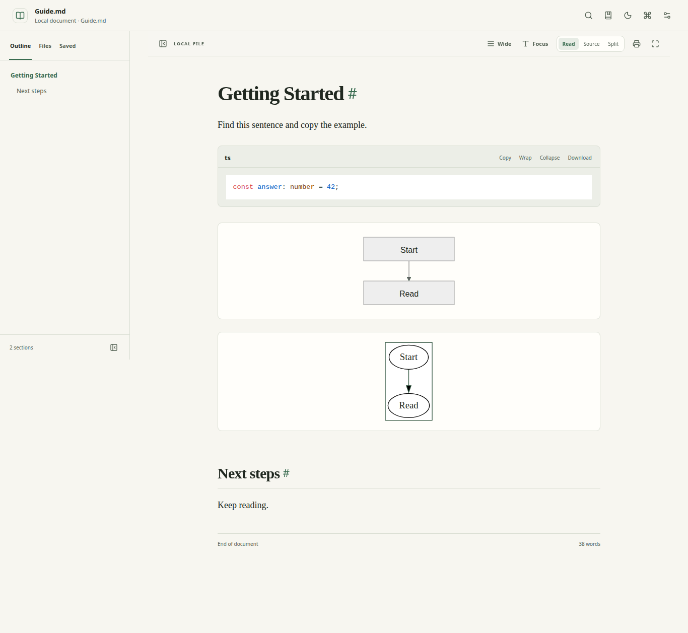

# Markdown Reader

Markdown Reader is a local-first reading application packaged as a browser extension. It opens Markdown from the web, local files, selected folders, and the current page, then renders it in a quiet, typography-led workspace.




## Features

- CommonMark and GitHub-style Markdown, including tables, task lists, alerts, footnotes, frontmatter, definition lists, containers, and inline marks.
- Local KaTeX mathematics, Mermaid diagrams, Graphviz DOT, and on-demand Highlight.js language modules.
- Local file picker, drag and drop, and folder workspace with Markdown navigation, relative Markdown links, and folder images.
- Direct HTTP(S) Markdown loading after a site-specific permission request. Automatic rendering can be enabled separately for a site.
- Current-page text capture initiated from the popup.
- Search, a command palette, a heading outline, section bookmarks, reading progress, source and split views, image lightbox, fullscreen, print, and PDF through the browser print dialog.
- Paper, Snow, Sepia, Graphite, Midnight, system, and user-created themes. Typography, spacing, width, code palette, and scoped document CSS are configurable.
- Optional remote-document reload while the reader is visible. The interval is configurable and off by default.
- Local preferences, optional reading positions, recent metadata, and bookmarks. Document contents are not saved to persistent history.

The interface is responsive and includes a folder drawer, keyboard help, and accessibility names and focus states. The current desktop and mobile screenshots are in [`screenshots/`](screenshots/).

## Install

Builds and ZIP files are generated in `.output/` by the commands below. ZIPs are for manual distribution or future store submission; they are not signed store releases.

### Chrome, Chromium, and Vivaldi

1. Run `npm ci` and `npm run build` from this project directory, or extract `markdown-reader-extension-1.0.0-chrome.zip`.
2. Open the browser's extensions page (`chrome://extensions` in Chrome, `vivaldi://extensions` in Vivaldi).
3. Turn on **Developer mode**, choose **Load unpacked**, and select `.output/chrome-mv3` (or the extracted ZIP directory containing `manifest.json`).
4. Pin Markdown Reader if you want it in the toolbar.

### Microsoft Edge

1. Build with `npm run build` or extract `markdown-reader-extension-1.0.0-chrome.zip`.
2. Open `edge://extensions`, turn on **Developer mode**, choose **Load unpacked**, and select `.output/chrome-mv3` (or the extracted package directory).

### Firefox

1. Run `npm ci` and `npm run build:firefox`, or extract `markdown-reader-extension-1.0.0-firefox.zip`.
2. Open `about:debugging#/runtime/this-firefox`, choose **Load Temporary Add-on…**, and select `.output/firefox-mv3/manifest.json`.

Firefox temporary add-ons are removed when Firefox closes. The generated Firefox package is not AMO-signed; store or persistent self-distribution requires Mozilla signing. The manifest declares that the extension collects no user data.

### Reading `file://` URLs

Chrome, Edge, and Vivaldi require **Allow access to file URLs** on the extension's details page to render a `file://` URL directly. This is optional. The reader's file picker, drag and drop, and folder picker do not depend on that browser setting.

## Development

Requirements: Node.js 22 or newer and npm. No global build packages are needed.

```sh
npm ci
npm run dev
npm run dev:firefox
```

`npm run dev` starts WXT's Chromium development build. Load the emitted development directory from `.output/` using the browser extension page.

## Build and test

```sh
npm run typecheck
npm test
npm run test:e2e
npm run build
npm run build:firefox
npm run zip
npm run zip:firefox
```

`npm run test:e2e` first runs a production Chrome build, then uses Playwright Chromium against a local preview of that bundle. Its browser API and remote fetch behavior are mocked; it does not install or launch the extension service worker. See [TESTING.md](TESTING.md) for scope and manual installation checks.

## Browser targets

- **Chrome / Chromium / Edge / Vivaldi:** Manifest V3 build; Chromium is the primary target.
- **Firefox:** WXT's Firefox Manifest V3 build. It has been built and packaged, but not runtime-tested in Firefox in this environment.

The UI was exercised using Playwright's bundled headless Chromium at mobile, tablet, desktop, and wide-desktop viewport sizes. No desktop Chrome, Edge, Vivaldi, or Firefox executable was available in the environment for a real extension installation test.

## Permissions

The extension asks for `activeTab`, `scripting`, `storage`, and `clipboardWrite`. `activeTab` and `scripting` are used after a user chooses **Render current page**; the extension reads only visible page text for that action. `storage` holds preferences and limited reader metadata. `clipboardWrite` supports code-copy controls.

HTTP and HTTPS hosts are optional. Opening a remote Markdown URL or enabling automatic rendering asks for access to that origin only. Redirects to another origin require that origin's permission too. No unrestricted host grant is requested silently.

## Privacy

Markdown parsing, syntax highlighting, diagram rendering, and mathematics run from bundled local code. There is no account, backend, analytics, telemetry, advertising, or cloud sync. Remote Markdown and remote images are the only document network requests: the former is user-initiated after an origin grant; the latter is disabled by default and can be enabled in settings.

Persistent local data consists of preferences, recent-document metadata, optional reading positions, bookmarks, and enabled automatic-render origins. Recent remote items retain their URL so they can be reopened; local paths and page text are not stored in persistent recents. Picked file and page content is handed to the reader through extension session storage and removed when consumed. Folder contents and image object URLs remain in the active reader session.

## Keyboard shortcuts

Inside the reader, Ctrl/Command+F searches, Ctrl/Command+K opens the command palette, Ctrl/Command+O opens a file, Ctrl/Command+Shift+O opens a folder, Ctrl/Command+Plus/Minus changes text size, T cycles themes, F toggles focus mode, `?` shows shortcut help, and Escape closes active overlays. The extension action defaults to Alt+Shift+M; browsers may let you change that action shortcut. In-page shortcuts are fixed.

## Known limitations

- MDX is treated as Markdown-compatible text; JSX and imports are never evaluated. `.txt` files are accepted only when opened explicitly.
- Local relative image resolution is available when the parent folder is selected. A lone file picker cannot grant access to neighboring assets.
- Folder contents are session-only, limited to 2,500 files, and cannot be watched for filesystem changes. Live reload applies to remote documents, not local files.
- Reopening a local file or captured page from Recents or a bookmark requires the user to open that source again. The extension does not retain local file handles or page contents.
- A bookmark for an inactive document is retained as metadata; reopen that document to navigate to the saved heading.
- Remote image loading can reveal the reader's IP address to the image host, so it is off by default.
- Equation numbering and a configurable in-reader shortcut editor are not implemented.
- The production bundle is relatively large because it includes offline diagram and math engines. See the build notes in [TESTING.md](TESTING.md).

## Project docs

- [Architecture](ARCHITECTURE.md)
- [Security and privacy model](SECURITY.md)
- [Testing and QA](TESTING.md)
- [Changelog](CHANGELOG.md)
- [Contributing](CONTRIBUTING.md)
- [Claude Code handoff](CLAUDE_HANDOFF.md)
- [Installed engineering skills and mirror maintenance](.agents/skills/skills-manifest.md)
