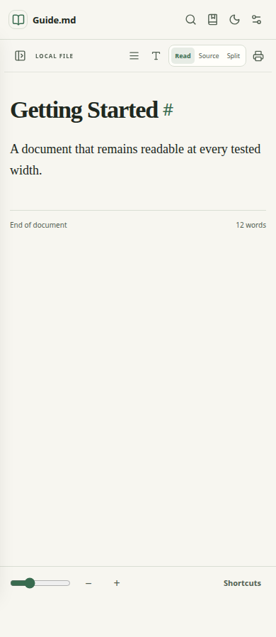

# Markdown Reader

Markdown Reader is a local-first reading application packaged as a browser extension. It opens Markdown from the web, local files, selected folders, and the current page, then renders it in a quiet, typography-led workspace.




## Features

- CommonMark and GitHub-style Markdown, including tables, task lists, alerts, footnotes, frontmatter, definition lists, containers, and inline marks.
- Local KaTeX mathematics, Mermaid diagrams, Graphviz DOT, and on-demand Highlight.js language modules.
- Local file picker, drag and drop, and folder workspace with Markdown navigation, relative Markdown links, and folder images.
- Direct HTTP(S) Markdown loading after a request for that one site.
- Automatic opening for each site you choose: a Markdown link on that site opens in the reader, while ordinary web pages are left alone.
- Optional automatic opening of local Markdown files (`file://`), once you turn it on and the browser allows file access.
- Current-page text capture initiated from the popup.
- Search, a command palette, a heading outline, section bookmarks, reading progress, source and split views, image lightbox, fullscreen, print, and PDF through the browser print dialog.
- Paper, Snow, Sepia, Graphite, Midnight, system, and user-created themes. Typography, spacing, width, code palette, and scoped document CSS are configurable.
- Optional remote-document reload while the reader is visible. The interval is configurable and off by default.
- Local preferences, optional reading positions, recent metadata, and bookmarks. Document contents are not saved to persistent history.

The interface is responsive and includes a folder drawer, keyboard help, and accessibility names and focus states. The current desktop and mobile screenshots are in [`screenshots/`](screenshots/).

## Install

Builds and ZIP files are generated in `.output/` by the commands below. ZIPs are for manual distribution or future store submission; they are not signed store releases.

### Chrome, Chromium, and Vivaldi

1. Run `npm ci` and `npm run build` from this project directory, or extract `markdown-reader-extension-1.0.0-chrome.zip`.
2. Open the browser's extensions page (`chrome://extensions` in Chrome, `vivaldi://extensions` in Vivaldi).
3. Turn on **Developer mode**, choose **Load unpacked**, and select `.output/chrome-mv3` (or the extracted ZIP directory containing `manifest.json`).
4. Pin Markdown Reader if you want it in the toolbar.

### Microsoft Edge

1. Build with `npm run build` or extract `markdown-reader-extension-1.0.0-chrome.zip`.
2. Open `edge://extensions`, turn on **Developer mode**, choose **Load unpacked**, and select `.output/chrome-mv3` (or the extracted package directory).

### Firefox

1. Run `npm ci` and `npm run build:firefox`, or extract `markdown-reader-extension-1.0.0-firefox.zip`.
2. Open `about:debugging#/runtime/this-firefox`, choose **Load Temporary Add-on…**, and select `.output/firefox-mv3/manifest.json`.

Firefox temporary add-ons are removed when Firefox closes. The generated Firefox package is not AMO-signed; store or persistent self-distribution requires Mozilla signing. The manifest declares that the extension collects no user data.

## Automatic opening

Turn it on from the popup while you are on a site: **Open Markdown links automatically**. The browser then asks for access to that one site. After that, a top-level page on that site that is served as plain text with a `.md`, `.markdown`, `.mdx`, `.mkd`, `.mkdn`, `.mdown`, or `.mdwn` name, or with a Markdown media type, opens in the reader. HTML pages are never redirected, including HTML served at a `.md` address and rendered GitHub Markdown pages. Turn it off the same way, or in Settings, where every enabled site is listed.

### Local Markdown files

Markdown Reader can also open a local Markdown file that you open directly in the browser (a `file://` address, for example by dragging a file onto the tab bar). It needs two things, and both must stay on:

1. **Your opt-in.** In Settings › File handling, turn on **Automatically open local Markdown files**. It is off by default.
2. **The browser's file access for the extension.**
   - Chrome, Edge, Vivaldi, and other Chromium browsers: open the extension's details page (Settings has an **Open extension settings** button) and turn on **Allow access to file URLs**. The browser restarts the extension when this changes, so an open Settings tab may close.
   - Firefox 153 or later: open the Firefox menu › **Add-ons and themes**, choose Markdown Reader, open **Permissions and data**, and turn on **Access local files on your computer**.

Settings shows whether local automatic opening is on, off, waiting for browser permission, or unavailable in this browser. Turning the switch off, or removing the browser permission, stops automatic opening immediately.

Files ending in `.md`, `.markdown`, `.mdx`, `.mkd`, `.mkdn`, `.mdown`, or `.mdwn` (any letter case) are opened when the browser displays them as text. HTML, PDF, images, `.txt`, executables, and other files are never redirected. Whether a browser displays a given extension or downloads it depends on the browser and the operating system's file-type database: on the Linux machine used for testing, Chromium downloaded `.mdx` files instead of displaying them, so they never reached the reader; Firefox displayed all seven.

Limits:

- Chromium reads the file again on each reader reload. Firefox does not let extension pages read `file://` addresses, so the page's text is handed to the reader through in-memory session storage. In Firefox, files larger than 4 MB and files reopened after a browser restart need **Open file**.
- Relative images and links inside a local file are not resolved. Open the parent folder with **Open folder** for that.
- Network-share addresses (`file://server/…`) are not opened.

## Development

Requirements: Node.js 22 or newer and npm. No global build packages are needed.

```sh
npm ci
npm run dev
npm run dev:firefox
```

`npm run dev` starts WXT's Chromium development build. Load the emitted development directory from `.output/` using the browser extension page. `npm ci` also runs `wxt prepare`, which generates the `.wxt/` TypeScript configuration that the type checker needs.

## Build and test

```sh
npm run typecheck
npm test
npm run test:e2e
npm run build
npm run build:firefox
npm run zip
npm run zip:firefox
```

`npm run test:e2e` runs two Playwright projects. The `preview` project drives the built pages with mocked extension APIs. The `extension-runtime` project loads the unpacked test build into a real Chromium profile and tests the service worker, popup, options page, reader, and automatic opening. Set `MARKDOWN_READER_CHROME_PATH` to a Chrome or Chromium binary if Playwright's bundled browser is not installed. See [TESTING.md](TESTING.md) for scope, commands, and limits.

## Browser targets

- **Chrome / Chromium / Edge / Vivaldi:** Manifest V3 build. The installed-extension suite runs in headless Chrome for Testing 153. Branded Chrome 137 and later does not load unpacked extensions from the command line, so that suite cannot use it.
- **Firefox:** Manifest V3 build with `web-ext` static lint. Local-file automatic opening is runtime-tested in Firefox 160 (`npm run test:firefox`); the rest of the Firefox runtime is not.

## Permissions

The extension asks for `activeTab`, `scripting`, `storage`, and `clipboardWrite`. `activeTab` and `scripting` are used after a user chooses **Read this page**; the extension reads only visible page text for that action. `storage` holds preferences and limited reader metadata. `clipboardWrite` supports code-copy controls.

HTTP and HTTPS hosts are optional. Opening a remote Markdown URL or enabling automatic opening asks for access to that origin only. No unrestricted host grant is requested silently. Automatic opening registers its content script only for origins you have granted.

The manifest also declares the `file:///*` host permission for local automatic opening. It shows no install warning: Chromium uses it only after you turn on **Allow access to file URLs**, and Firefox 153+ only after you turn on **Access local files on your computer**.

The extension also exposes its reader page to web pages and local files (`web_accessible_resources`). This is what lets an automatic-open redirect load the reader. Chrome randomizes that address, so other sites cannot predict it from the extension ID. The reader only fetches documents from origins you have granted, but any site can open the reader page. See [SECURITY.md](SECURITY.md) for the full trade-off.

## Privacy

Markdown parsing, syntax highlighting, diagram rendering, and mathematics run from bundled local code. There is no account, backend, analytics, telemetry, advertising, or cloud sync. Remote Markdown and remote images are the only document network requests: the former is user-initiated after an origin grant; the latter is disabled by default and can be enabled in settings.

Persistent local data consists of preferences, recent-document metadata, optional reading positions, bookmarks, and automatic-opening sites. Recent remote items retain their URL so they can be reopened; local paths and page text are not stored in persistent recents. Picked file and page content is handed to the reader through extension session storage and removed when consumed. Folder contents and image object URLs remain in the active reader session.

## Keyboard shortcuts

Inside the reader, Ctrl/Command+F searches, Ctrl/Command+K opens the command palette, Ctrl/Command+O opens a file, Ctrl/Command+Shift+O opens a folder, Ctrl/Command+Plus/Minus changes text size, T cycles themes, F toggles focus mode, `?` shows shortcut help, and Escape closes active overlays. The extension action defaults to Alt+Shift+M; browsers may let you change that action shortcut. In-page shortcuts are fixed.

## Known limitations

- MDX is treated as Markdown-compatible text; JSX and imports are never evaluated. `.txt` files are accepted only when opened explicitly.
- Automatic opening covers only sites you enable one at a time, plus local files when you opt in and the browser grants file access. See "Local Markdown files" above for browser-specific limits.
- Reloading the reader after a *website* opened it automatically shows a "blocked" page in Chromium. Local-file opening is not affected. See SECURITY.md "Open items".
- Local relative image resolution is available when the parent folder is selected. A lone file picker cannot grant access to neighboring assets.
- Folder contents are session-only, limited to 2,500 files, and cannot be watched for filesystem changes. Live reload applies to remote documents, not local files.
- Reopening a local file or captured page from Recents or a bookmark requires the user to open that source again. The extension does not retain local file handles or page contents.
- A bookmark for an inactive document is retained as metadata; reopen that document to navigate to the saved heading.
- Remote image loading can reveal the reader's IP address to the image host, so it is off by default.
- Single-key shortcuts (T, F, `?`) cannot be turned off yet.
- Equation numbering and a configurable in-reader shortcut editor are not implemented.
- The production bundle is relatively large because it includes offline diagram and math engines. See the build notes in [TESTING.md](TESTING.md).

## Project docs

- [Architecture](ARCHITECTURE.md)
- [Security and privacy model](SECURITY.md)
- [Testing and QA](TESTING.md)
- [Changelog](CHANGELOG.md)
- [Contributing](CONTRIBUTING.md)
- [Claude Code handoff](CLAUDE_HANDOFF.md)
- [Installed engineering skills and mirror maintenance](.agents/skills/skills-manifest.md)
