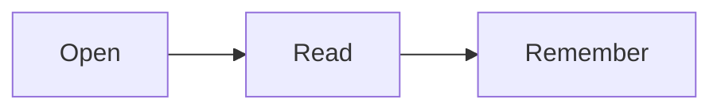
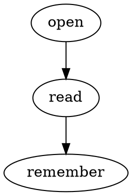

# A calm place to read

The reader keeps **technical detail** legible without turning a document into a dashboard.

## Lists and notes

- First point
- Second point
  - Nested point

1. Set a goal
2. Read the section

- [x] Keep the source local
- [ ] Follow a cross-file link

> A quotation should remain distinct from the surrounding prose.

> [!TIP]
> Use the outline to move between sections.

## Tables

| Format | Local | Notes |
| --- | :---: | --- |
| Markdown | yes | `README.md` |
| Diagram | yes | Mermaid and DOT |

## Footnotes and inline marks

Read slowly[^one]. H~2~O, x^2^, ++inserted++, ==highlighted==, and :sparkles:.

[^one]: Footnotes return readers to the original sentence.

## Mathematics

Einstein's equation is $E = mc^2$.

$$
\int_0^1 x^2\,dx = \frac{1}{3}
$$

## Diagrams





## Code

```typescript
type Note = { title: string; tags: string[] };
const note: Note = { title: 'Fieldnote', tags: ['local'] };
console.log(note.title);
```

## A longer passage

Reading progresses one sentence at a time. This section is intentionally repeated so the progress meter, search behavior, page rhythm, and long-document scrolling can be inspected with realistic content. The complete source stays in the browser session and is never sent to a service.

Repeat the previous sentence in several sections to create a useful reading length. A short fixture can prove that a parser works, but it cannot show whether the composition remains comfortable after several screens of text.

## Related reading

Return to [the start](#a-calm-place-to-read) or open [the architecture guide](./ARCHITECTURE.md).
